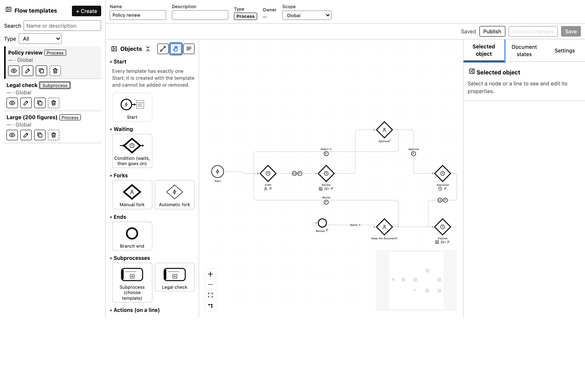
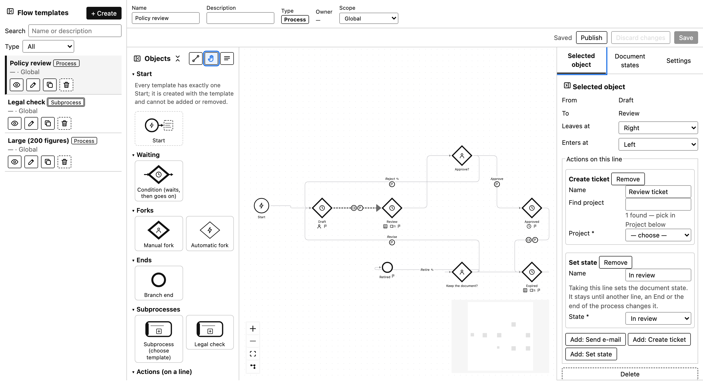

# Návrh šablony procesu

Šablony navrhují admini Confluence v administraci LINA (záložka **Šablony**) a — pokud to konfigurace aplikace dovoluje — admini prostoru pro svůj prostor (*Space settings* → *Integrations* → LINA → **Šablony procesů**). Návrhář je na obou místech stejný.

Nejrychlejší začátek je kopie [ukázkové šablony](examples.md#hotové-ukázkové-šablony): vyberte jednu označenou **Přibalená** a klikněte na **Kopírovat** (ikona dvou listů). Pak změňte, co potřebujete.

## Návrhář v kostce

- *Vlevo:* seznam šablon. **Vytvořit** → **Vytvořit proces** nebo **Vytvořit podproces**. Každá šablona má ikony **Zobrazit** (oko), **Upravit** (tužka), **Kopírovat** (dva listy), **Exportovat** (šipka dolů) a **Smazat** (koš); po najetí myší na ikonu uvidíte její název. **Hledat** nad seznamem najde šablony podle názvu nebo popisu (na velkých / malých písmenech a diakritice nezáleží).
- *Uprostřed:* plocha s paletou **Objekty**. Ikona dvojité šipky vedle **Objekty** rozbalí všechny skupiny palety (**Rozbalit vše**) nebo je sbalí (**Sbalit vše**).
- *Vpravo:* **Vybraný objekt** — vlastnosti figury nebo čáry, na kterou jste klikli. Klik na figuru nebo čáru vždy přepne na tuto záložku.
- *Nahoře:* **Uložit** (uchová koncept) a **Publikovat** (šablonu zkontroluje a zmrazí jako novou verzi). Záložky **Stavy dokumentu** a **Nastavení** patří otevřené šabloně.

Když figuru pustíte, její střed se usadí na nejbližší tečku plochy, takže se figury snadno zarovnají. **Uspořádat obrázek** (tlačítko pod tlačítky přiblížení vlevo dole) srovná všechny figury do sloupců a řádků od Startu a čáry vrátí na automatickou trasu; **Uložit** výsledek ponechá, **Zahodit změny** ho vrátí.

Každý sloupec jde sbalit, aby měla plocha víc místa. Sbalený pravý panel dál vypisuje své záložky; kliknutím jednu otevřete.

## Vytvoření šablony

1. **Vytvořit** → **Vytvořit proces**.
2. Vyplňte **Název** (jedinečný) a volitelně **Popis**.
3. **Rozsah**: **Globální** (nabízí se v každém prostoru), nebo **Vybrané prostory**.
4. Šablona začíná figurou **Start**. Přidejte figury a čáry, pak **Uložit**.

## Přidání figur

Přetáhněte figuru z palety **Objekty** na plochu. Po najetí myší na objekt v paletě uvidíte, k čemu slouží. Poslední ikona v hlavičce palety přepíná mezi obrázky a **Jen text**. Nové figury dostanou název jako *Podmínka 1*; přejmenujte je ve **Vybraný objekt** — název je to, co lidé vidí na stránce (*LINA · Kontrola*).

| V paletě | Figura |
|---|---|
| **Podmínka (počká, pak jde dál)** | čeká na tickety, člověka nebo termín |
| **Ruční rozcestí** | větev vybere člověk |
| **Automatické rozcestí** | větev se řídí stavem dokumentu |
| **Konec větve** | Konec |
| **Podproces (vybrat šablonu)** | spustí šablonu podprocesu; uložené podprocesy jsou vypsané i jménem v části *Podprocesy* |

Figuru nebo čáru smažete tak, že ji vyberete a stisknete Delete (nebo **Smazat** v panelu). Start smazat nejde.

## Kreslení čar

1. V hlavičce palety **Objekty** klikněte na ikonu čáry (**Nakreslit čáru**, dvě tečky spojené čarou).
2. Klikněte na figuru a pak na jinou. Spojí je čára.
3. Nástroj čáry zůstane zapnutý, takže hned můžete kreslit další čáru. Zpět na přesouvání a výběr přepnete ikonou ruky (**Přesouvat a vybírat**), nebo klávesou Esc.

Čáru jde také táhnout z tečky na okraji figury k jiné figuře. Esc nebo klik na prázdné místo rozkreslenou čáru zruší.

Nebo na figuru klikněte pravým tlačítkem, vyberte **Přidat čáru** a klikněte na figuru, kam čára vede. Z Konce nic nevede, proto je tam položka šedá.

Čáru přesunete tak, že jeden její konec přetáhnete na jinou figuru — nad koncem čáry se kurzor změní na tužku. Čára si ponechá akce i nastavení. Platí stejná pravidla jako při kreslení: žádná čára do Startu ani z Konce a druhá čára z Podmínky dostane Ruční rozcestí.

Nová čára si strany vybírá **Automaticky** — podle toho, kde je druhá figura (vpravo: ven vpravo, dovnitř vlevo; níž: ven dole, dovnitř nahoře), a při posunu figury je přizpůsobí. Čáry nakreslené dřív vycházejí vpravo a vstupují vlevo. Každá figura má tečku na všech čtyřech stranách; tečky se ukážou, když na figuru ukážete nebo kreslíte čáru. Tečka pod figurou je pod jejím názvem a značkami. Přetáhněte konec čáry na jinou tečku a čára použije tu stranu, nebo čáru vyberte a zvolte **Vychází** a **Vstupuje** (**Automaticky**, **Vpravo**, **Dole**, **Nahoře**, **Vlevo**). Strana, kterou vyberete, zůstane. Kde dvě čáry končí ve stejné tečce, nejdřív vyberte tu, kterou chcete — tažení vezme vybranou čáru.

Na vybrané čáře slouží jako úchyt její popisek uprostřed (kroužky podmínky a akcí v modrém rámečku); čára bez popisku má místo něj malý čtvereček. Tažením čáru posunete napříč, třeba dál od jiné čáry nebo figury. Počítá se jen směr napříč čárou; rovná čára mezi dvěma figurami v řadě nemá kam se posunout. Dvojklik na úchyt nebo **Zpět automatická trasa** v panelu čáry nechá LINA čáru zase vést sama. Pohled na běh na stránce ukazuje čáru stejně.

Start, Podmínka a Podproces mají *jednu* čáru ven. Když z Podmínky nakreslíte druhou čáru, LINA za ni vloží **Ruční rozcestí** a obě čáry vedou z něj.

## Na co čeká Podmínka nebo Konec

Vyberte figuru. V části **Pokračuje, když** (u Konce **Končí, když**) zaškrtněte cokoli z:

- **Jsou hotové všechny povinné tickety tohoto procesu** — každý ticket, který zatím cestou vznikl jako *povinný*. „Hotový“ znamená kategorii stavu v Jiře zvolenou v [nastavení prostoru](space-settings.md) (výchozí *Done*).
- **Člověk potvrdí (klikne Pokračovat)**
- **Uplynul termín** — pak nastavte **Odkud se termín vezme**, viz [Termíny a připomínky](due-dates.md).

Platit musí všechno zaškrtnuté. Bez **Člověk potvrdí (klikne Pokračovat)** se proces posune sám, jakmile to platí.

Konec, kde není nic zaškrtnuté, ukončí proces hned, jak tam dojde. Konec v podprocesu musí na něco čekat — tím říká, kdy je podproces hotový.

## Rozcestí

*Ruční rozcestí:* každá čára ven potřebuje popisek — vyberte čáru a vyplňte **Popisek (zobrazí se nad čarou)**, například *Schválit*. Lidé na stránce uvidí popisky jako volby. Zaškrtněte **Volba této větve vyžaduje komentář**, kde je potřeba důvod, například u *Zamítnout*.

*Automatické rozcestí:* nastavte **Rozděluje podle** na **Stavu dokumentu**. Každá čára ven je **Pro stav dokumentu** jednoho stavu; jednu čáru označte **Větev „jinak“** pro všechny ostatní stavy a pro dokument bez stavu. Šablona nejdřív potřebuje [stavy dokumentu](document-states.md).

> V této verzi umí automatické rozcestí větvit jen podle stavu dokumentu. Volbu **Ano / ne** zatím nejde publikovat.

Čáry mohou vést zpět k dřívější figuře, například *Zamítnout* zpět na *Koncept*. Proces tam pak začne nové kolo.

## Akce na čáře

1. Vyberte akci v paletě (**Založit ticket**, **Poslat e-mail**, **Nastavit stav**) a klikněte na čáru. Nebo čáru vyberte a použijte **Přidat** v části **Akce na této čáře**.
2. Akci vyplňte ve **Vybraný objekt**.

Akce na první čáře (ze Startu) proběhnou při spuštění procesu.

### Založit ticket

1. **Najít projekt**, pak vyberte **Projekt** a **Typ ticketu**. LINA načte z Jiry pole formuláře pro založení.
2. Vyplňte **Shrnutí**, **Popis** a všechna povinná pole.
3. Zaškrtněte **Povinný pro schválení (brána na tento ticket čeká)**, pokud na něj má dokument čekat.
4. **Zkopírovat termín figury, kam čára vede, do pole Due date ticketu** je výchozí zapnuté — viz [Termíny](due-dates.md#termín-v-jiře).

Tickety se zakládají pod **Servisní účet** šablony (viz [Nastavení](#nastavení)), nebo je zakládá sama LINA, když žádný není.

### Poslat e-mail

Napište **Text** a vyberte lidi v poli **Zmínit**. LINA text zapíše jako komentář na stránku se zmínkou těchto lidí; e-mail pošle Confluence.

### Nastavit stav

Vyberte **Stav**. Viz [Stavy dokumentu](document-states.md).

### Zástupné značky

Do polí ticketu a textu e-mailu můžete psát:

| Značka | Doplní se |
|---|---|
| `{page}` | název stránky |
| `{link}` | odkaz na stránku |
| `{user}` | kdo udělal krok |
| `{date}` | dnešek |
| `{process}` | název šablony |
| `{step}` | kam vede tato čára |
| `{due}` | termín |

## Podprocesy

Podproces je šablona typu **Podproces** (**Vytvořit** → **Vytvořit podproces**). Hodí se na část, která se opakuje ve více procesech, například jazykovou kontrolu s vlastním ticketem.

- V hlavním procesu přidejte figuru Podproces a vyberte šablonu.
- Podproces se spustí sám, když tam proces dojde; když platí jeho Konec, hlavní proces sám pokračuje.
- Podproces nemůže obsahovat další podproces.
- Když podproces skončí, může nastavit stav dokumentu (**Když podproces skončí, nastavit stav dokumentu**).
- Na stránce odznak ukazuje, kde běh uvnitř podprocesu je, například *Jazyková kontrola › Korektura*.

## Nastavení

Záložka šablony **Nastavení**:

- **Servisní účet** — účet, pod kterým se zakládají tickety. Nastavit ho smí jen admini Confluence a jen ze [seznamu povolených](app-configuration.md#povolené-servisní-účty). Bez něj tickety zakládá LINA.
- **Kdo smí tento proces spustit a ukončit** — pro **Spustit** a **Ukončit** zvlášť: **Kdokoli, kdo stránku vidí**, **Kdokoli, kdo smí stránku upravit**, nebo **Jen tito lidé a skupiny**. Admini prostoru smí spouštět a ukončovat vždy. Kdo šablonu spustit nesmí, ten ji na stránce nevidí. Platí po **Uložit**, bez publikace.

## Uložení a publikace

- **Uložit** uchová koncept. Stránky dál používají poslední publikovanou verzi.
- **Zahodit změny** zahodí, co jste od posledního **Uložit** změnili, a znovu ukáže poslední uloženou verzi — hodí se po nechtěném smazání. LINA se nejdřív zeptá; **Pokračovat v úpravách** se vrátí bez zahození. Postupné vracení po krocích není.
- **Publikovat** uloženou šablonu zkontroluje a zmrazí jako novou verzi. Pokud něco chybí, LINA vypíše co a kde — například *Čára „Ruční rozcestí 1 → Konec“ z ručního rozcestí potřebuje popisek.* Všechny kontroly jsou v [Kontrolách při publikaci](reference/publish-checks.md). Figury a čáry jmenované v seznamu jsou na ploše červené, dokud něco nezměníte. Problém se stavem dokumentu (bez názvu, bez skupiny, stejný název dvakrát) místo toho označí červeně záložku **Stavy dokumentu**.
- Publikace kontroluje i přístup v Jiře: že účet, pod kterým se zakládají tickety, je smí v projektu zakládat, že typ issue existuje a že jsou vyplněná povinná pole. Jmenovitě řekne, co chybí.
- Pokud šablonu mezitím uložil někdo jiný, LINA ji odmítne přepsat — nejdřív ji znovu načtěte.

Běhy, které už začaly, si ponechají verzi, se kterou začaly.

## Kopírování a mazání

- **Kopírovat** vytvoří nový koncept šablony se stejným nákresem a stavy. Servisní účet se nekopíruje.
- **Smazat** šablonu odstraní. Běžící procesy doběhnou podle kopie, se kterou začaly. Šablonu podprocesu, kterou používá jiná šablona, smazat nejde.

## Export a import

Soubor poslouží jako záloha šablon, nebo k přenesení stejného procesu na jiný Confluence site.

- **Exportovat** (šipka dolů u šablony) stáhne šablonu jako soubor JSON i se šablonami podprocesů, které používá.
- **Exportovat vše** nad seznamem stáhne všechny šablony daného místa do jednoho souboru: v administraci aplikace globální šablony, v *Nastavení prostoru* → *LINA* šablony toho prostoru. Ukázkové šablony a globální šablony zobrazené v prostoru v souboru nejsou — nejdřív si je zkopírujte.
- **Importovat…** takový soubor načte a každou šablonu přidá jako nový *koncept*; nic se samo nepublikuje. Šablona, jejíž název je obsazený, dostane na konec „(imported)“. Figury podprocesu ukazují na šablony podprocesů importované s nimi.

Co soubor nese: název, popis, rozsah, kdo smí spustit a ukončit, nákres a stavy. Co nenese: servisní účet, vlastníka, publikované verze a běžící procesy. Projekty v Jiře, lidé a prostory v nákresu zůstanou, jak byly — na jiném siteu je před publikací zkontrolujte; publikace řekne, co chybí. V prostoru je importovaná šablona vždy omezená na ten prostor.

## Ukázkové šablony

Seznam začíná hotovými ukázkami označenými **Přibalená**: *Document lifecycle*, *Procedure with proofreading* (s podprocesem *Proofreading*), *New procedures start by themselves*, *Specification to Jira work* a *Decision record*. Můžete je jen zobrazit a kopírovat. K čemu která je a co po **Kopírovat** vyplnit: [Příklady](examples.md#hotové-ukázkové-šablony).

Kopie ukázky, která používá podproces, zkopíruje i podproces a kopie ukazuje na zkopírovaný podproces. Podproces publikujte jako první.
