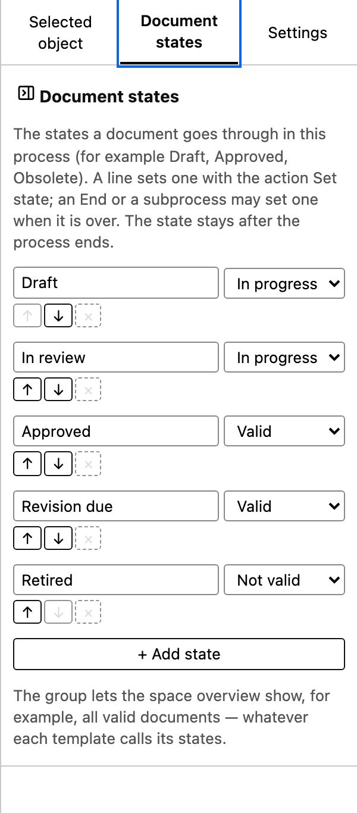

# Stavy dokumentu

Stav dokumentu říká, co dokument *je*: *Koncept*, *Schváleno*, *K revizi*, *Vyřazeno*. Je oddělený od toho, kde je proces, a *zůstává i po skončení procesu* — schválená směrnice zůstane *Schváleno*, i když na ní už nic neběží.

## Stavy v šabloně

Otevřete záložku šablony **Stavy dokumentu**:

1. **Přidat stav** a vyplňte jeho **Název**.
2. Vyberte **Skupina**:
   - **Rozpracovaný** — píše se nebo kontroluje,
   - **Platný** — lidé se na něj mohou spolehnout,
   - **Neplatný** — propadlý, stažený, nahrazený.
3. Pořadí stavů měníte tlačítky **Posunout nahoru** / **Posunout dolů**. **Odebrat** jde jen stav, který proces nepoužívá.

Díky skupině LINA zachází se stavy různých šablon stejně: přehled prostoru i [hledání](find-documents-by-state.md) umí ukázat „všechny platné dokumenty“, ať jim jednotlivé šablony říkají jakkoli.

## Změna stavu

- U figury **Start**: **Při startu procesu nastav stav dokumentu** — dokument má stav od první chvíle, ať proces spustí člověk, nebo pravidlo.
- Akce **Nastavit stav** na čáře — stav se změní, když proces jde po čáře.
  **Nastavit stav** na čáře ze Startu proběhne hned po Startu, takže zůstane jeho stav.
- U figury **Konec**: **Když proces skončí tady, nastavit stav dokumentu**.
- U figury **Podproces**: **Když podproces skončí, nastavit stav dokumentu**.
- Kdo proces předčasně ukončí, vybere **Stav dokumentu po ukončení**.

Stav se mění jen procesem. Úprava stránky ho nezmění.

## Větvení podle stavu

**Automatické rozcestí** s volbou **Rozděluje podle** = **Stavu dokumentu** jde čarou pro aktuální stav. Jednu čáru označte jako **Větev „jinak“** pro stavy bez vlastní čáry. Viz [Návrh šablony procesu](design-a-template.md#rozcestí).

## Kde lidé stav vidí

- Odznak vedle názvu stránky: *LINA · Schváleno*.
- Panel na stránce: **Stav dokumentu:** v barvě podle skupiny.
- **Dokumenty podle stavu:** v [přehledu prostoru](space-overview.md).
- [Panel v Jiře](jira.md) u každého ticketu založeného z dokumentu.
- Hledání v Confluence: `lina_state = "Approved"` — viz [Hledání dokumentů podle stavu](find-documents-by-state.md).

## Dokumenty, které už neplatí

Stránka, jejíž stav patří do skupiny **Neplatný**, ukazuje čtenářům nad obsahem pruh **Tento dokument už neplatí** se stavem a procesem. Čtenář ho může **Zavřít**. Díky tomu se nikdo omylem neřídí vyřazeným postupem.

## Zkopírované stránky

Kopie stránky stav ani proces nepřebírá. Začíná bez stavu — pokud ji šablona [nespustí automaticky i u kopií](start-automatically.md).
