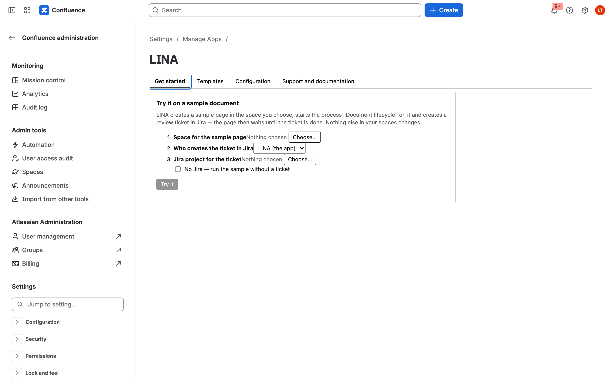
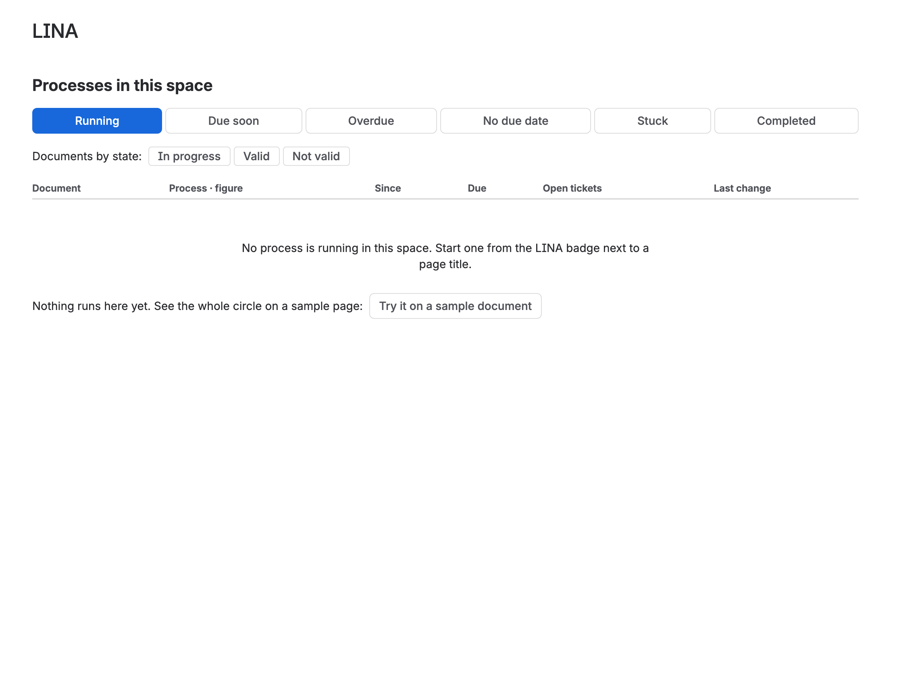

# Začínáme

Celý kruh — stránku, která čeká na ticket v Jiře a sama se posune, když je ticket hotový — uvidíte zhruba za deset minut a nic přitom nenavrhujete.

## Než začnete

- LINA je nainstalovaná pro Confluence. Jira je volitelná: bez ní ukázka proběhne bez ticketu.
- Jste admin Confluence, nebo admin prostoru, kam ukázka půjde.

## Jak otevřít administraci LINA

Admini Confluence: klikněte na ozubené kolo (*Confluence administration*) → v postranním panelu pod *Settings* rozbalte *Apps* → **LINA**.

Administrace se otevře na záložce **Začínáme**, vedle jsou **Šablony**, **Konfigurace** a **Podpora a dokumentace** (odkazy na tuto dokumentaci a na podporu). Na stejnou stránku vede i odkaz *Get Started*, který se ukáže po instalaci aplikace.

Admini prostoru bez práv admina Confluence mohou ukázku spustit z [přehledu prostoru](space-overview.md) svého prostoru: dokud v něm nic neběží, přehled ji nabízí.

## Vyzkoušejte to na ukázkovém dokumentu

Na záložce **Začínáme**:

1. **Prostor pro ukázkovou stránku** — vyberte prostor.
2. **Kdo založí ticket v Jiře** — **LINA (aplikace)**, nebo servisní účet, pokud ho váš admin [povolil](app-configuration.md#povolené-servisní-účty).
3. **Projekt Jiry pro ticket** — projekt, kde sami smíte zakládat issues. Nemáte Jiru? Zaškrtněte **Bez Jiry — ukázka bez ticketu**.
4. Klikněte na **Vyzkoušet**.

LINA vytvoří:

- publikovanou šablonu *Document lifecycle (sample)*, nabízenou jen v tomto prostoru,
- ukázkovou stránku, jejímž autorem jste vy,
- na ní běžící proces, který už založil ticket ke kontrole a teď čeká u *Review*.

Klikněte na **Otevřít ukázkovou stránku**.

## Na co se podívat

1. *Odznak vedle názvu stránky* ukazuje, kde dokument je, například *LINA · In review · Review*. Klikněte na něj.
2. Panel vypíše ticket ke kontrole, jeho stav v Jiře a *Nejde pokračovat: 1 z 1 povinných ticketů není hotových.* Není tu co kliknout: stránka čeká.
3. *Zavřete ticket v Jiře* (přesuňte ho do stavu kategorie *Done*). Otevřete stránku znovu: proces se sám posunul na *Approve?*, kde člověk vybere *Approve* nebo *Reject*.
4. Jednu možnost vyberte. **Ukázat historii** řekne, kdo co kdy udělal, včetně ticketu, který LINA založila.
5. Otevřete **Zobrazit průběh procesu** — uvidíte nákres procesu a kde v něm stránka je.
6. V postranním panelu prostoru otevřete *Space apps* → LINA a uvidíte [přehled prostoru](space-overview.md).

## Co dál

- Udělejte si vlastní proces: zkopírujte jednu z pěti [ukázkových šablon](examples.md#hotové-ukázkové-šablony) — kontrola a roční revize, korektura, automatický start pro nové stránky, specifikace do práce v Jiře, záznam rozhodnutí — a upravte ji. Viz [Návrh šablony procesu](design-a-template.md).
- Ať nové stránky dostávají proces samy: [Automatické spuštění procesu](start-automatically.md).
- Rozhodněte, co se počítá za hotový ticket a kdo smí čekání přeskočit: [Nastavení prostoru](space-settings.md).

Ukázka je obyčejná stránka a šablona. Až je nebudete potřebovat, smažte je.
