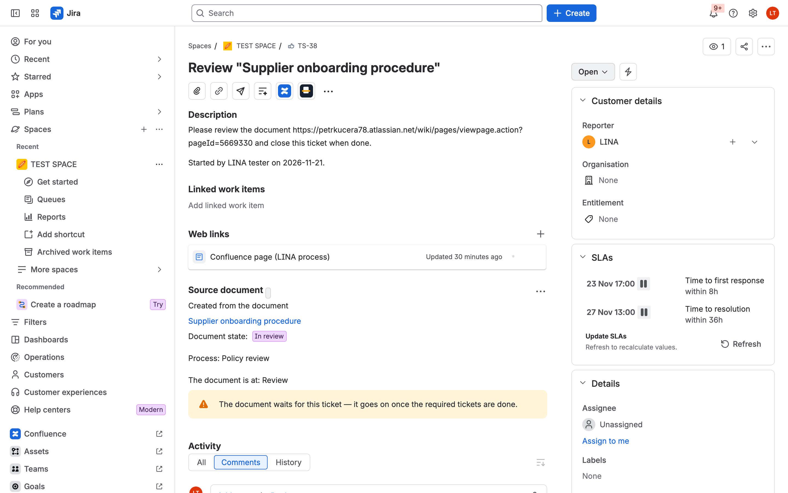

# LINA v Jiře

LINA v Jiře nic nastavovat nepotřebuje. Tickety zakládá z Confluence a čte je, když dokument čeká.

## Tickety založené procesem

- Ticket zakládá akce **Založit ticket** na čáře šablony — v projektu, s typem issue a poli vybranými v [návrháři](design-a-template.md#založit-ticket).
- Zakládá se pod servisním účtem šablony, nebo pod LINA.
- Dostane odkaz na stránku v Confluence.
- Pokud čára vede k figuře s termínem, ticket dostane tento *Due date* ([Termíny](due-dates.md#termín-v-jiře)).
- Když se proces předčasně ukončí, jeho otevřené tickety dostanou o tom komentář.

*Povinný* ticket drží dokument, dokud není hotový. „Hotový“ je kategorie stavu v Jiře nastavená v [nastavení prostoru](space-settings.md#kdy-je-ticket-hotový) — výchozí *Done*. Ticket zavřete běžným způsobem v Jiře; dokument se pak posune sám.

## Panel Source document

Každý ticket založený LINA má v Jiře panel *Source document*. Ukazuje:

- **Založen z dokumentu** — odkaz na stránku,
- proces a kde dokument právě je (*Dokument je u: Review*),
- **Stav dokumentu:**,
- termín,
- co ticket pro dokument znamená:
  - *Povinný: dokument nemůže pokračovat, dokud je tento ticket otevřený.*
  - *Dokument čeká na tento ticket — pokračuje, až budou povinné tickety hotové.*
  - *Doprovodný ticket: dokument na něj nečeká.*
- jestli je proces dokončený, ukončený, nebo už začal další běh.

Pokud stránku v Confluence otevřít nemůžete, panel ji nejmenuje: *Tento ticket založil proces LINA na stránce Confluence, kterou nemůžete otevřít.*

## Dobré vědět

- Smazání povinného ticketu nebo jeho přesun tam, kam LINA nevidí, nechá dokument čekat. Někdo oprávněný musí [přesto pokračovat](work-on-a-page.md#přesto-pokračovat).
- LINA nemění workflow v Jiře a nepotřebuje admina Jiry.
- Jira je volitelná. Bez ní šablony prostě nemají akce s tickety.
