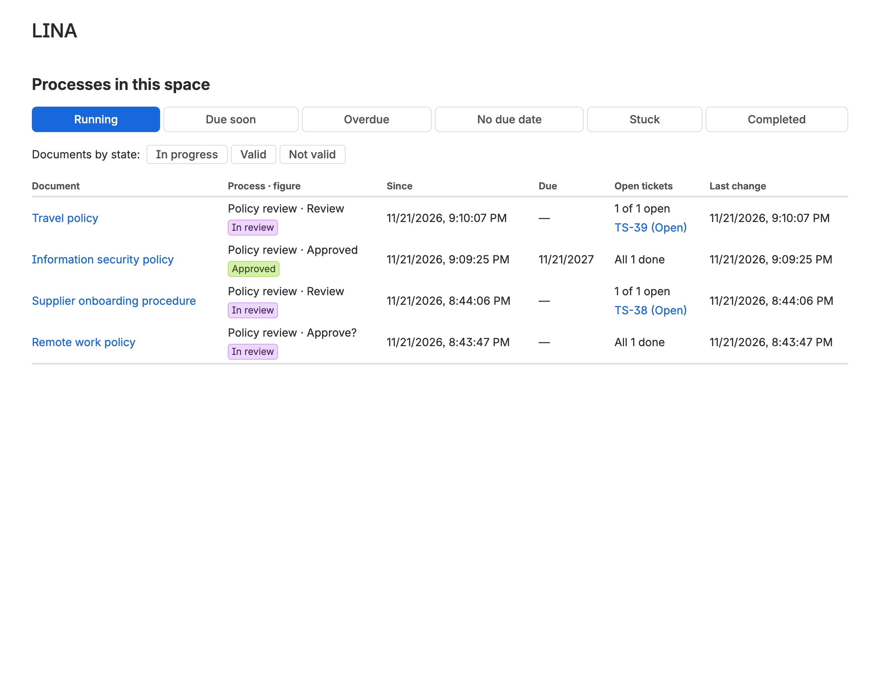

# Přehled prostoru

**Procesy v tomto prostoru** vypisuje dokumenty jednoho prostoru a kde jsou jejich procesy. Otevřete ho z postranního panelu prostoru: *Space apps* → LINA.

## Pohledy

| Pohled | Ukazuje |
|---|---|
| **Běžící** | každý běžící proces |
| **Brzy termín** | běžící procesy s termínem v příštích 14 dnech, nejbližší první |
| **Po termínu** | procesy, jejichž aktuální figura je po termínu |
| **Bez termínu** | běžící procesy, jejichž aktuální figura termín nemá |
| **Uvízlé** | procesy, které nemohou samy pokračovat — stavu dokumentu neodpovídá žádná čára |
| **Dokončené** | dokončené a ukončené procesy |

V části **Dokumenty podle stavu:** vypíšete dokumenty skupiny **Rozpracované**, **Platné** nebo **Neplatné** — i ty, jejichž proces už skončil.

## Sloupce

- **Dokument** — odkaz na stránku.
- **Proces · figura** — název šablony a kde běh je.
- **Od** — kdy tam dorazil.
- **Termín** — termín aktuální figury; ty po termínu jsou označené.
- **Otevřené tickety** — například *1 z 2 otevřeno*, s odkazy a stavem v Jiře; *Všech 2 hotovo*; nebo poznámka, když Jiru nešlo přečíst nebo se ticket nezaložil.
- **Poslední změna**

Seznam ukazuje 25 řádků; **Načíst další** ukáže další.

## Proč dokument čeká

1. Najděte dokument v **Běžící** nebo **Po termínu**.
2. **Otevřené tickety** řeknou, které tickety jsou ještě otevřené; odkaz vás zavede do Jiry, kde uvidíte, komu jsou přiřazené.
3. Otevřete dokument a klikněte na jeho odznak — uvidíte celý obraz i [historii](work-on-a-page.md#historie).

## Co nevidíte

Dokumenty, které nesmíte otevřít, se nevypíšou. Přehled řekne kolik: *Běhy na stránkách, které nevidíte: 2.*

## Prázdný prostor

Když v prostoru zatím žádný proces neběží, admini prostoru tu uvidí nabídku vyzkoušet LINA na ukázkovém dokumentu — viz [Začínáme](getting-started.md#vyzkoušejte-to-na-ukázkovém-dokumentu).
