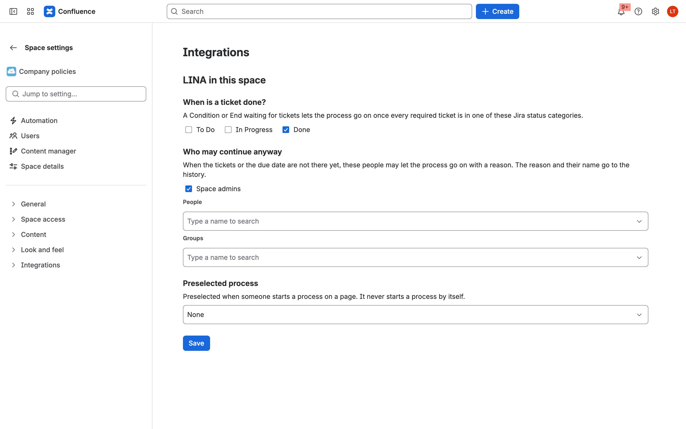

# Nastavení prostoru

Admini prostoru nastavují, jak se LINA chová v jejich prostoru: *Space settings* → *Integrations* → LINA. Tady je popsaná záložka **Nastavení**; **Šablony procesů** (když aplikace šablony v prostorech dovoluje) je [návrhář](design-a-template.md) pro tento prostor.

Osobní prostory nastavení LINA nemají; platí výchozí hodnoty.

## Kdy je ticket hotový?

Podmínka nebo Konec, které čekají na tickety, pustí dokument dál, jakmile je každý povinný ticket v jedné z *kategorií stavů* Jiry, které tu zaškrtnete: **K udělání**, **Rozpracováno**, **Hotovo**. Výchozí je jen **Hotovo**.

Jira řadí každý stav workflow do jedné z těchto tří kategorií, takže to funguje napříč projekty s různými workflow. Zaškrtněte i **Rozpracováno**, pokud se má například už „In review“ počítat jako hotové.

## Kdo smí přesto pokračovat

Tito lidé smí pustit dokument dál dřív, než jsou jeho tickety hotové nebo než uplyne termín, s povinným důvodem ([Přesto pokračovat](work-on-a-page.md#přesto-pokračovat)):

- **Admini prostoru** (výchozí zapnuto),
- **Lidé** — vybraní jménem,
- **Skupiny** — členství se ověřuje ve chvíli, kdy to někdo zkouší.

Když všechno vypnete, čekání v tomto prostoru nesmí přeskočit nikdo.

## Předvybraný proces

Šablona předvybraná, když někdo spouští proces na stránce v tomto prostoru. **Žádný** = nic předvybráno. Sám proces nikdy nespustí.

Klikněte na **Uložit**. Pokud nastavení ve stejnou chvíli změnil někdo jiný, LINA ho znovu načte a požádá vás, abyste změnu udělali znovu.
