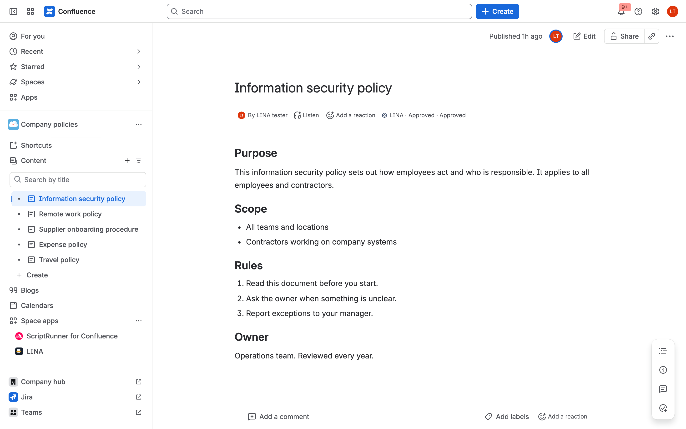
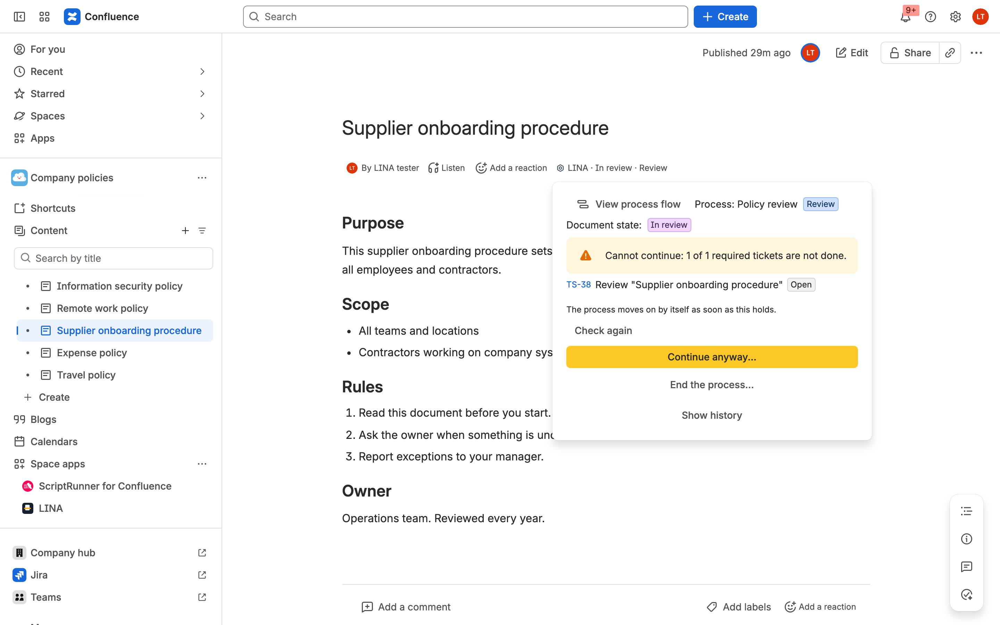
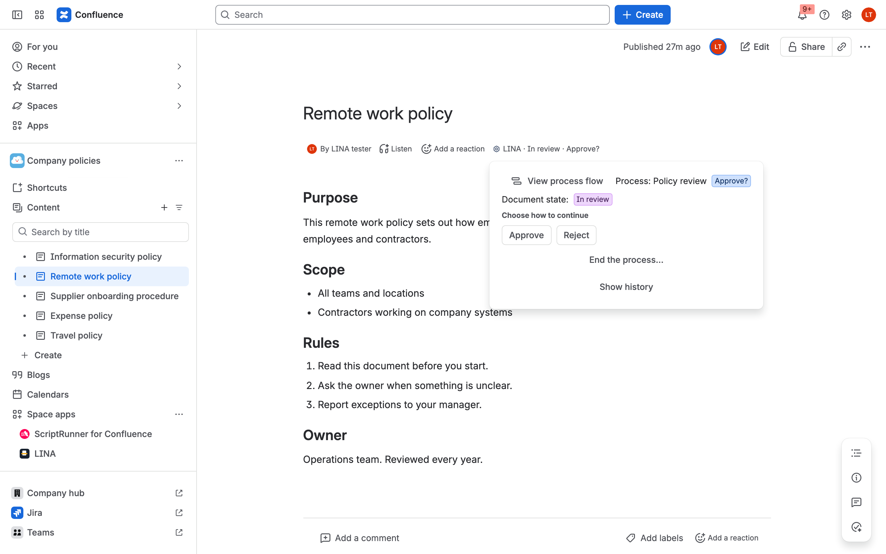
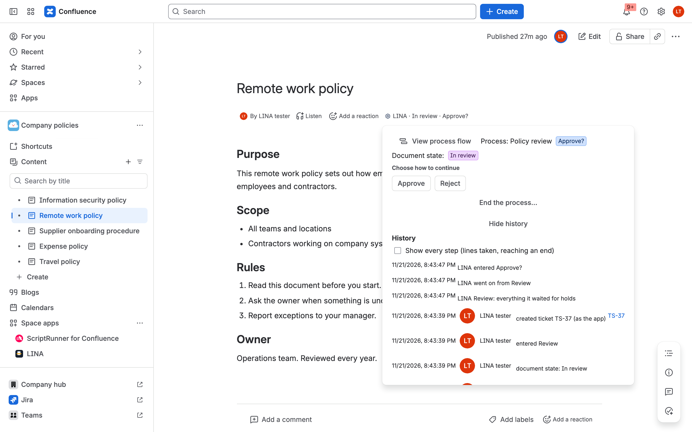

# Práce s procesem na stránce

Všechno se děje v odznaku **LINA** vedle názvu stránky. Kliknutím na něj otevřete panel.

Odznak ukazuje, kde dokument je:

| Odznak | Význam |
|---|---|
| *LINA* | na stránce neběží žádný proces |
| *LINA · Kontrola* | běží proces a je u figury *Kontrola* |
| *LINA · Schváleno* | žádný proces neběží; stav dokumentu je *Schváleno* |
| *LINA · V kontrole · Kontrola* | stav *V kontrole*, proces u *Kontroly* |

## Spuštění procesu

1. Klikněte na odznak.
2. V poli **Proces ke spuštění** vyberte šablonu. 🌐 označuje šablonu pro všechny prostory, 🗂️ šablonu tohoto prostoru. Váš prostor může mít jednu předvybranou.
3. Pokud proces potřebuje termíny už při spuštění, zadejte je.
4. Klikněte na **Spustit**.

Proces vstoupí do první figury; akce na první čáře proběhnou hned (například vznikne ticket).

Vidíte jen šablony, které na této stránce smíte spustit. Pokud je seznam prázdný: *Na tuto stránku se nevztahuje žádná šablona, kterou smíte spustit.* — šablony patří jiným prostorům, startují jen pravidlem, nebo je smí spustit jen někdo. Zeptejte se vlastníka šablony.

## Na co dokument čeká

Když je proces u Podmínky nebo Konce, které čekají, panel ukazuje:

- každý ticket založený cestou, s jeho stavem v Jiře a odkazem; tickety, které nejsou povinné, jsou označené *(nepovinný)*;
- kolik povinných ticketů je ještě otevřených, například *Nejde pokračovat: 1 z 2 povinných ticketů není hotových.*;
- termín, pokud se na něj čeká;
- *Proces se posune sám, jakmile tohle platí.* — když není potřeba nic kliknout.

Proces se posune sám, když se ticket v Jiře změní, když někdo otevře stránku, nebo při denní kontrole. Kliknutím na **Zkontrolovat znovu** se podíváte hned.

Pokud ticket nejde přečíst — *V Jiře nenalezen, nebo ho LINA nesmí vidět.* — dokument čeká. Stává se to, když byl ticket smazán nebo přesunut do projektu, kam LINA nemá přístup. Viz [Řešení potíží](troubleshooting.md).

## Pokračovat

Pokud figura čeká na **Člověk potvrdí (klikne Pokračovat)**, klikněte na **Pokračovat**, jakmile platí všechno ostatní. Pokud všechno neplatí, LINA seznam obnoví a řekne, co chybí.

## Výběr, jak pokračovat

U ručního rozcestí panel ukáže **Vyberte, jak pokračovat** s tlačítkem pro každou větev, například *Schválit* a *Zamítnout*. Některé větve vyžadují komentář: napište ho a potvrďte. Komentář jde do historie.

## Zadání nebo změna termínu

Pokud figura čeká na termín, který musí někdo zadat, panel napíše *Čeká, až někdo zadá termín.* Klikněte na **Zadat termín**, vyberte datum a **Uložit datum**. Později můžete **Změnit termín**. Tickety založené cestou, které termín přebírají, dostanou nové datum i v Jiře. Viz [Termíny a připomínky](due-dates.md).

## Přesto pokračovat

Někdy práci nejde dokončit — odpovědný člověk odešel, ticket už není potřeba. Lidé povolení v [nastavení prostoru](space-settings.md#kdo-smí-přesto-pokračovat) (výchozí jsou admini prostoru) vidí **Přesto pokračovat…**:

1. Klikněte na **Přesto pokračovat…**.
2. Napište proč — je to povinné.
3. Klikněte na **Přesto pokračovat**.

Historie zaznamená vaše jméno a důvod. Otevřené tickety v Jiře zůstanou, jak jsou.

Pod zavřenou bránou panel řekne, kdo smí v tomto prostoru přesto pokračovat, například *Dřív, než tohle platí, smí pokračovat jen admini prostoru.*

## Předčasné ukončení procesu

1. Klikněte na **Ukončit proces…**.
2. Napište proč — je to povinné.
3. Pokud má šablona stavy dokumentu, vyberte **Stav dokumentu po ukončení**: nechat aktuální, nastavit jiný, nebo bez stavu.
4. Klikněte na **Ukončit proces**.

LINA ke každému otevřenému ticketu běhu přidá komentář, že proces skončil. Samotné tickety se nezavírají.

Kdo smí proces ukončit, určuje šablona. Pokud vy ne: *Šablona tohoto procesu dovoluje ukončit ho jen některým lidem.*

Chcete-li na stránce jiný proces, ukončete běžící a spusťte nový. Běžící proces vyměnit nejde.

## Historie

Klikněte na **Ukázat historii**. Nejnovější záznamy jsou nahoře; **Další** načte starší. Každý záznam říká, kdo co kdy udělal — například *spustil proces*, *založil ticket DOC-12 (jako aplikace)*, *přesto pokračoval z Kontroly: autor odešel z firmy*. Klíče ticketů vedou do Jiry, e-mailové záznamy na komentář na stránce.

Zaškrtněte **Ukázat každý krok (průchody čarami, dosažení konce)** a uvidíte každou čáru, kudy proces šel.

Historie zůstává i po skončení procesu a po přesunu stránky do koše.

## Průběh procesu

**Zobrazit průběh procesu** ukáže nákres šablony, podle které běh jde, se zvýrazněnou aktuální figurou (zelená, když normálně čeká, červená, když proces uvízl). Po skončení běhu ukáže **Zobrazit průběh posledního běhu**, kde skončil. Přibližujte a posouvejte, jak potřebujete; nic se tu změnit nedá.

## Když proces uvízne

*Proces uvízl: nehodí se žádná čára.* znamená, že automatické rozcestí nenašlo čáru pro aktuální stav dokumentu. Obraťte se na vlastníka šablony — šablona potřebuje čáru pro tento stav nebo čáru *jinak*. [Přehled prostoru](space-overview.md) vypisuje uvízlé dokumenty v **Uvízlé**.

## Po skončení procesu

Odznak si ponechá stav dokumentu, pokud nějaký je. Panel napíše *Poslední proces (…) je dokončený.* nebo *Poslední proces (…) byl ukončen: důvod* a nabídne spustit proces znovu.
