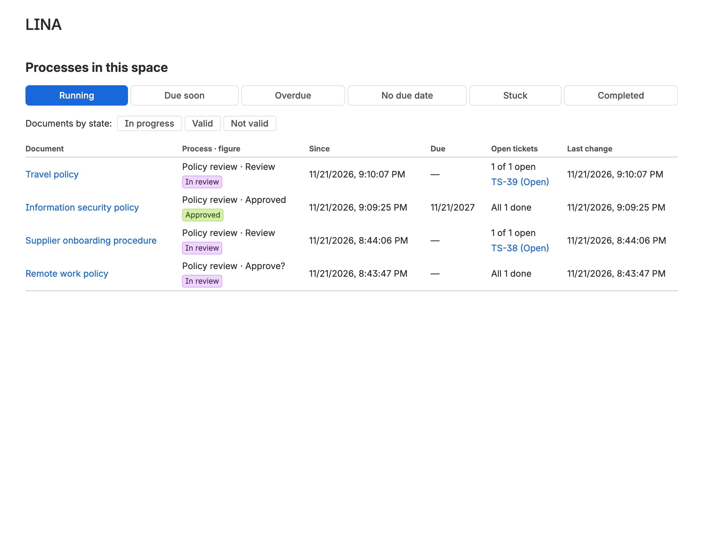

# Space overview

**Processes in this space** lists the documents of one space and where their processes are. Open it from the space sidebar: *Space apps* → LINA.

## Views

| View | Shows |
|---|---|
| **Running** | every running process |
| **Due soon** | running processes with a due date in the next 14 days, the nearest first |
| **Overdue** | processes whose current figure is past its due date |
| **No due date** | running processes whose current figure has no due date |
| **Stuck** | processes that cannot go on by themselves — no line fits the document state |
| **Completed** | finished and ended processes |

Under **Documents by state:** you can list documents of the group **In progress**, **Valid** or **Not valid** — including documents whose process has already ended.

## Columns

- **Document** — link to the page.
- **Process · figure** — template name and where the run is.
- **Since** — when it got there.
- **Due** — due date of the current figure; overdue ones are marked.
- **Open tickets** — for example *1 of 2 open*, with links and their Jira status; *All 2 done*; or a note when Jira could not be read or a ticket was not created.
- **Last change**

The list shows 25 rows; **Load more** shows the next ones.

## Finding out why a document waits

1. Find the document under **Running** or **Overdue**.
2. **Open tickets** tells you which tickets are still open; follow the link to see who they are assigned to in Jira.
3. Open the document and click its badge for the full picture and the [history](work-on-a-page.md#history).

## What you do not see

Documents you are not allowed to open are not listed. The overview says how many: *Runs on pages you cannot see: 2.*

## An empty space

When no process runs in the space yet, space admins see an offer to try LINA on a sample document right here — see [Getting started](getting-started.md#try-it-on-a-sample-document).
