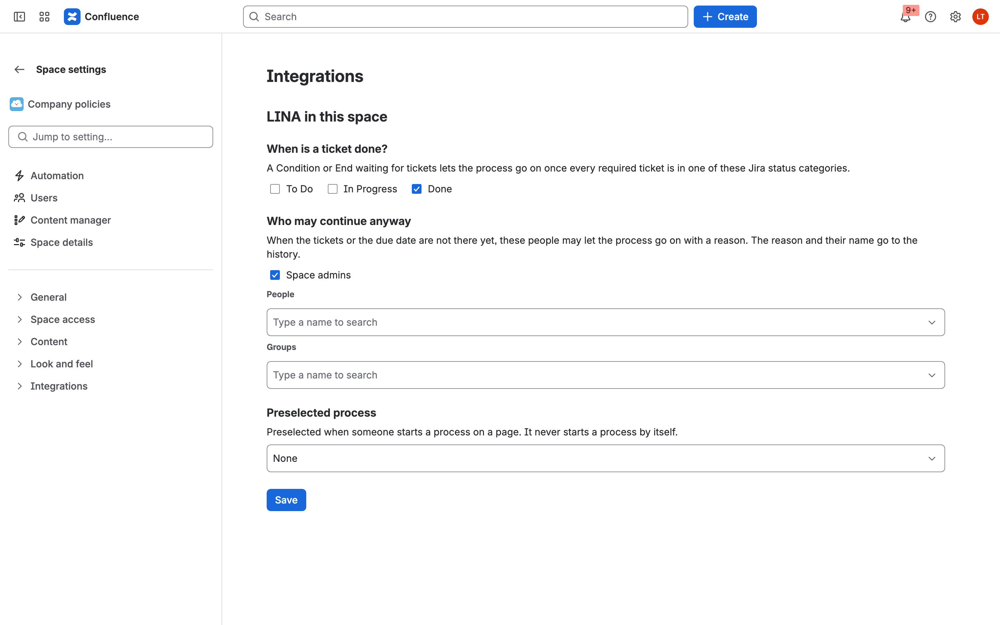

# Space settings

Space admins set how LINA behaves in their space: *Space settings* → *Integrations* → LINA. The **Settings** tab is described here; **Process templates** (when the app allows templates in spaces) is the [designer](design-a-template.md) for this space.

Personal spaces have no LINA settings; the defaults apply.

## When is a ticket done?

A Condition or End that waits for tickets lets the document go on once every required ticket is in one of the Jira *status categories* ticked here: **To Do**, **In Progress**, **Done**. The default is **Done** only.

Jira groups every workflow status into one of these three categories, so this works across projects with different workflows. Tick **In Progress** too if, for example, "In review" should already count.

## Who may continue anyway

These people may let a document go on before its tickets are done or its due date has passed, with a required reason ([Continue anyway](work-on-a-page.md#continue-anyway)):

- **Space admins** (on by default),
- **People** — chosen by name,
- **Groups** — membership is checked at the moment someone tries.

Turn everything off and nobody can skip the wait in this space.

## Preselected process

The template preselected when someone starts a process on a page in this space. **None** = nothing preselected. It never starts a process by itself.

Click **Save**. If someone else changed the settings at the same time, LINA reloads them and asks you to make your change again.
